# PDF Studio

Aplicación web para **convertir, editar y organizar archivos PDF** desde el navegador. Está formada por un frontend en React y una API REST en Spring Boot, orquestados con Docker Compose.

| Módulo | Descripción | Tecnología | Puerto |
|---|---|---|---|
| [`react-pdf`](./react-pdf/README.md) | Interfaz web (catálogo de herramientas, modales, tema claro/oscuro) | React 19 · Vite · Tailwind CSS 4 | `3003` (Docker) / `5173` (dev) |
| [`sbj-pdf`](./sbj-pdf/README.md) | API REST que procesa los PDF | Java 21 · Spring Boot 4 · Apache PDFBox | `9097` |

## Capturas de pantalla

| Tema claro | Tema oscuro |
|---|---|
| 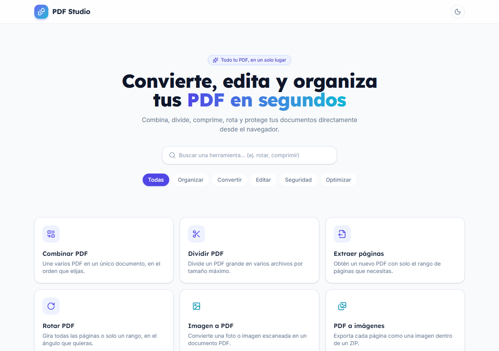 | 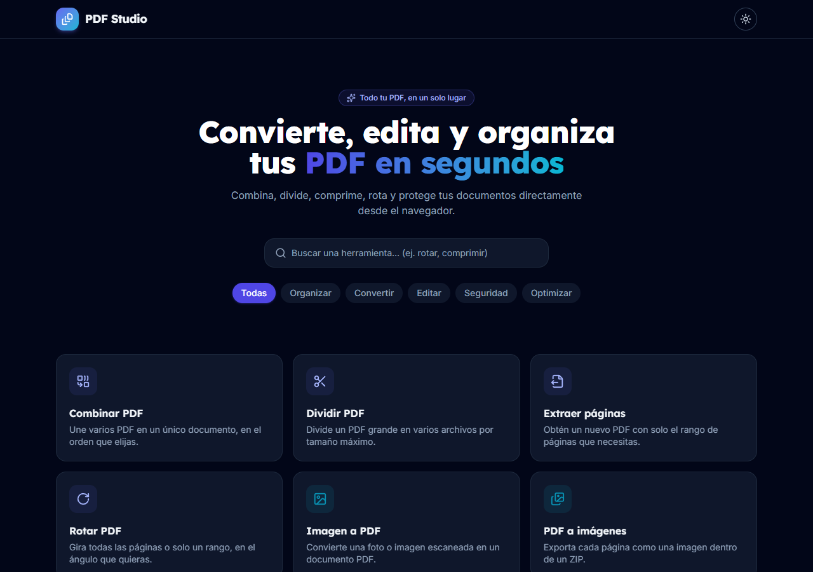 |

**Filtro por categoría** (ejemplo: *Seguridad*)

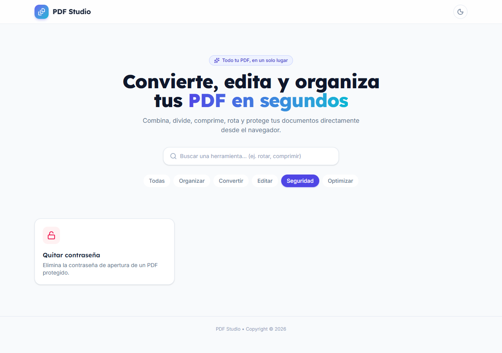

**Flujo de una herramienta** (ejemplo: *Rotar PDF*): formulario → archivo seleccionado → resultado

| 1. Formulario | 2. Archivo cargado | 3. Resultado |
|---|---|---|
| 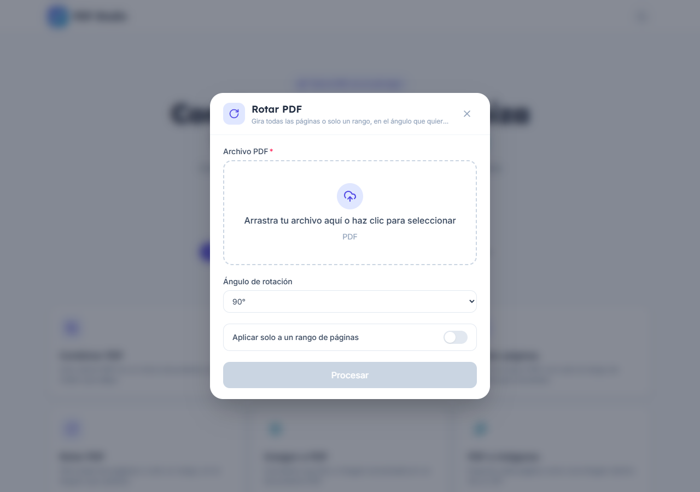 | 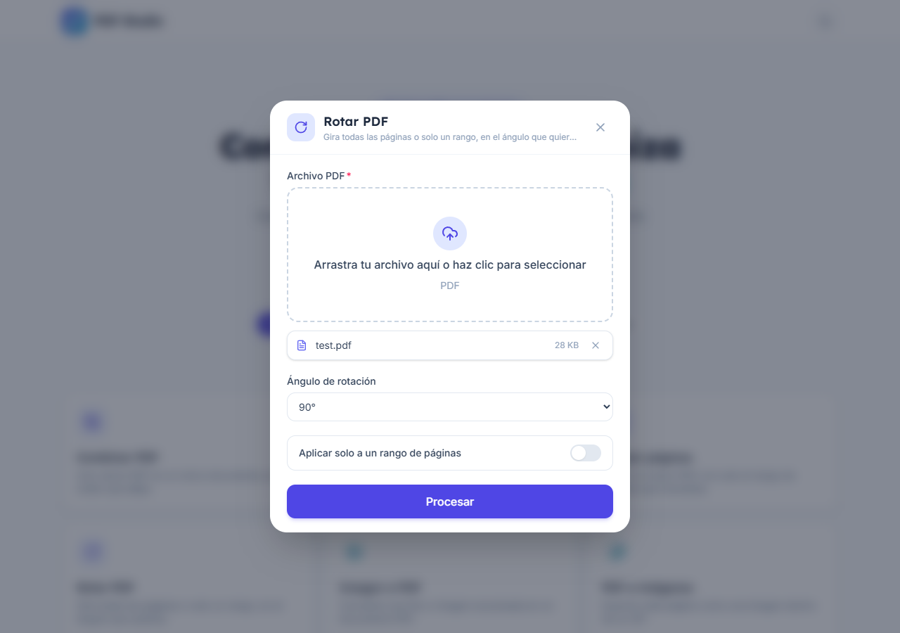 | 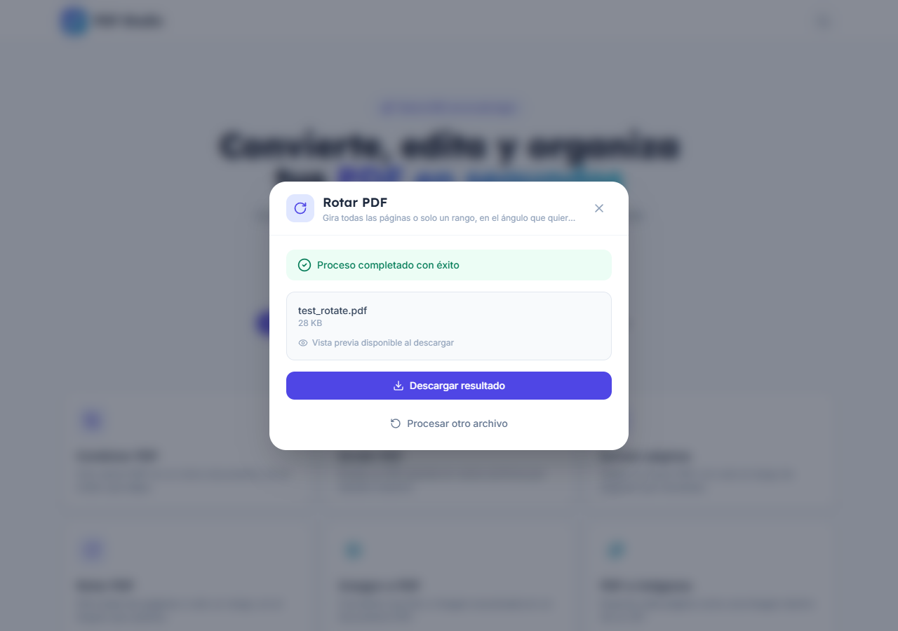 |

**Documentación interactiva de la API** (Swagger UI en `http://localhost:9097/swagger-ui/index.html`)

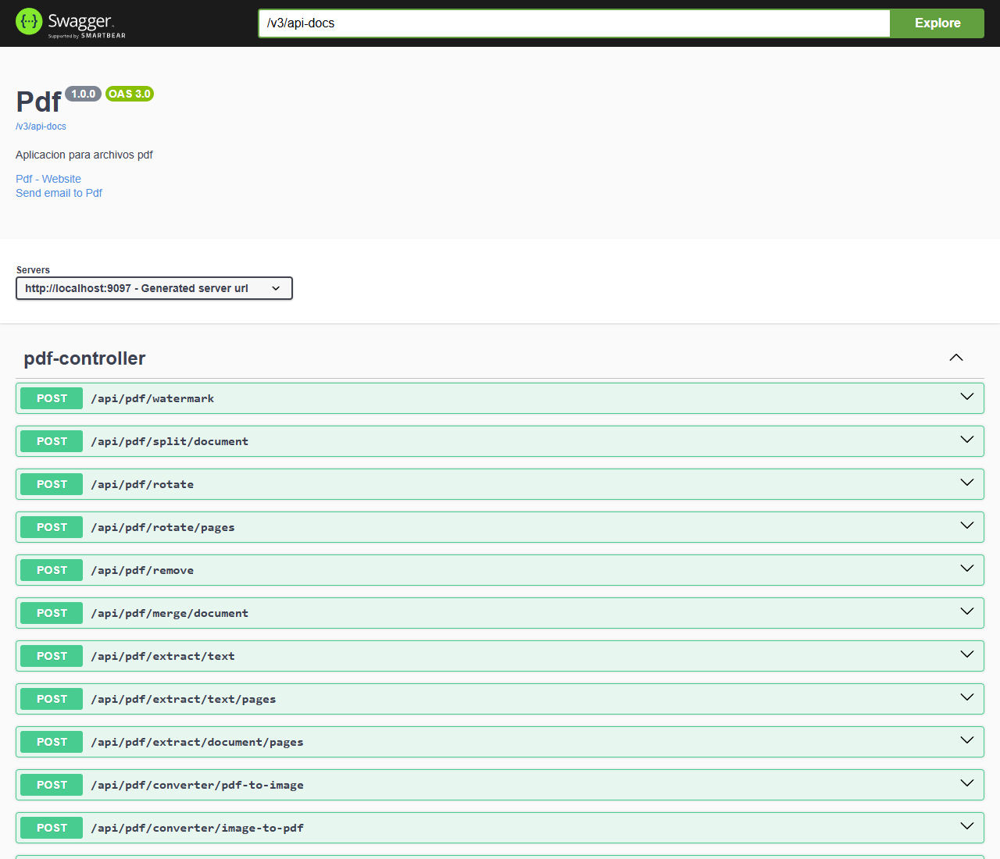

## Herramientas disponibles

| Categoría | Herramienta | Endpoint |
|---|---|---|
| Organizar | Combinar PDF | `POST /api/pdf/merge/document` |
| Organizar | Dividir PDF (por tamaño máximo, devuelve ZIP) | `POST /api/pdf/split/document` |
| Organizar | Extraer páginas | `POST /api/pdf/extract/document/pages` |
| Organizar | Rotar PDF (todo o por rango) | `POST /api/pdf/rotate` · `/rotate/pages` |
| Convertir | Imagen a PDF | `POST /api/pdf/converter/image-to-pdf` |
| Convertir | PDF a imágenes (ZIP, DPI configurable) | `POST /api/pdf/converter/pdf-to-image` |
| Editar | Extraer texto (todo o por rango) | `POST /api/pdf/extract/text` · `/extract/text/pages` |
| Editar | Marca de agua | `POST /api/pdf/watermark` |
| Seguridad | Quitar contraseña | `POST /api/pdf/remove` |
| Optimizar | Comprimir PDF | `POST /api/pdf/compress/document` |

## Arquitectura

### Diagrama de componentes

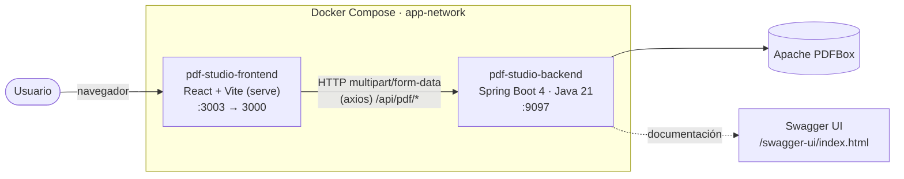

### Diagrama de despliegue

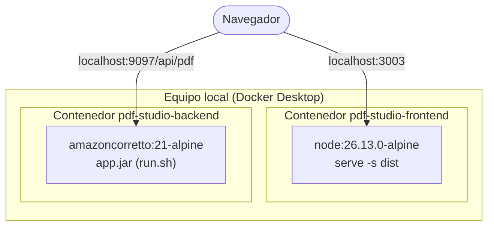

### Diagrama de clases — backend (`sbj-pdf`)

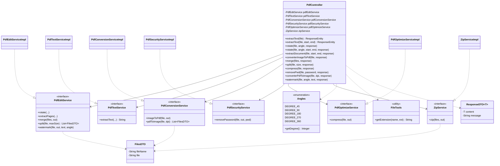

### Diagrama de componentes — frontend (`react-pdf`)

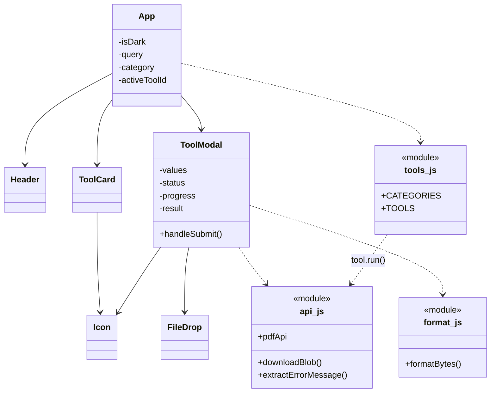

### Diagrama de secuencia — procesar un PDF (rotar)

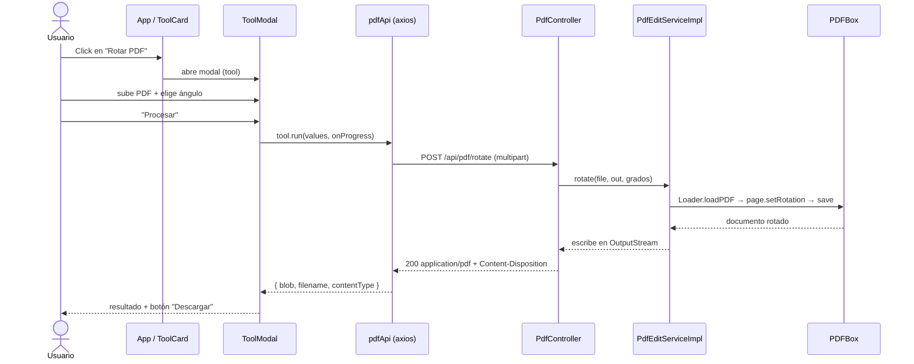

### Casos de uso

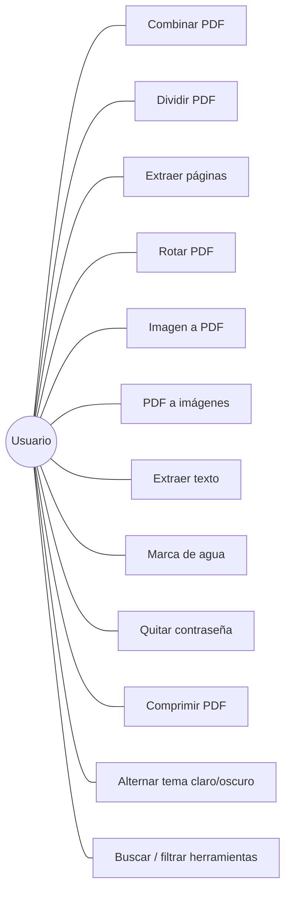

## Puesta en marcha

### Con Docker (recomendado)

Requisitos: Docker y Docker Compose.

```bash
docker compose up -d --build
```

| Servicio | URL |
|---|---|
| Frontend | http://localhost:3003 |
| API | http://localhost:9097/api/pdf |
| Swagger UI | http://localhost:9097/swagger-ui/index.html |

Detener y limpiar:

```bash
docker compose down
```

### Sin Docker (desarrollo)

```bash
# Backend (Java 21 + Maven)
cd sbj-pdf
mvn spring-boot:run            # http://localhost:9097

# Frontend (Node 20+)
cd react-pdf
npm install
npm run dev                    # http://localhost:5173
```

El frontend lee la URL de la API de `VITE_API_BASE_URL` (por defecto `http://localhost:9097/api/pdf`, ver `react-pdf/.env`).

## Estructura del repositorio

```
pdf_converter/
├── docker-compose.yml      # frontend + backend en la red app-network
├── docs/screenshots/       # capturas usadas en este README
├── react-pdf/              # frontend (React + Vite + Tailwind)
└── sbj-pdf/                # backend (Spring Boot + PDFBox)
```

## Notas

- El tamaño máximo de subida es de **100 MB** por archivo y por petición (`application.properties`).
- La contraseña de *Quitar contraseña* viaja en **Base64** (codificación, no cifrado); usa HTTPS si lo expones fuera de localhost.
- La URL de la API se define en build con `VITE_API_BASE_URL` (por defecto `http://localhost:9097/api/pdf`). Para cambiarla: `VITE_API_BASE_URL=https://mi-host/api/pdf docker compose up -d --build`. Debe ser accesible desde el navegador, no el hostname interno de Docker.
