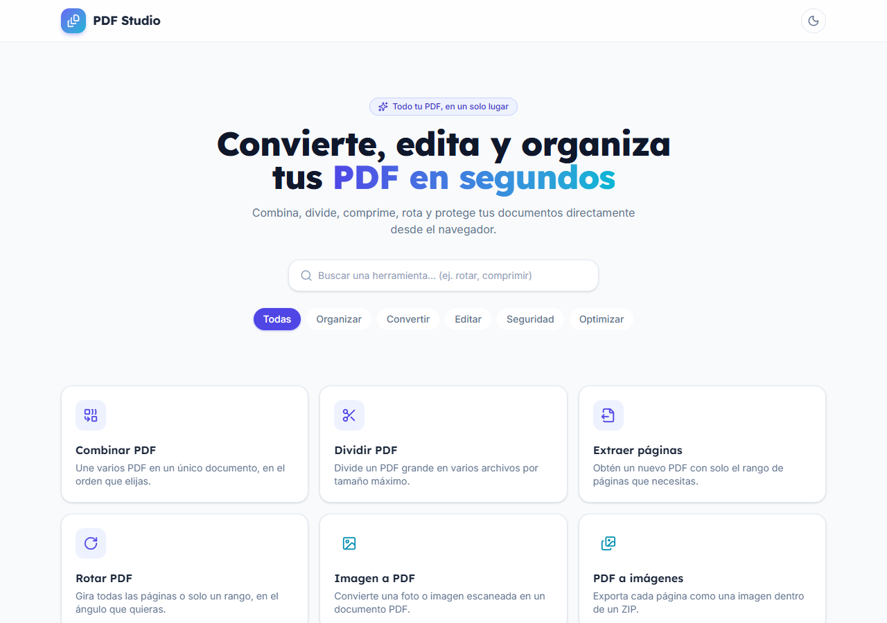
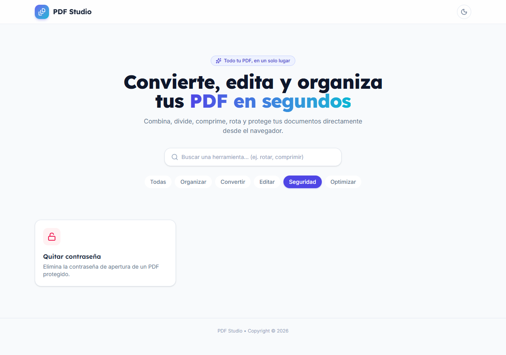
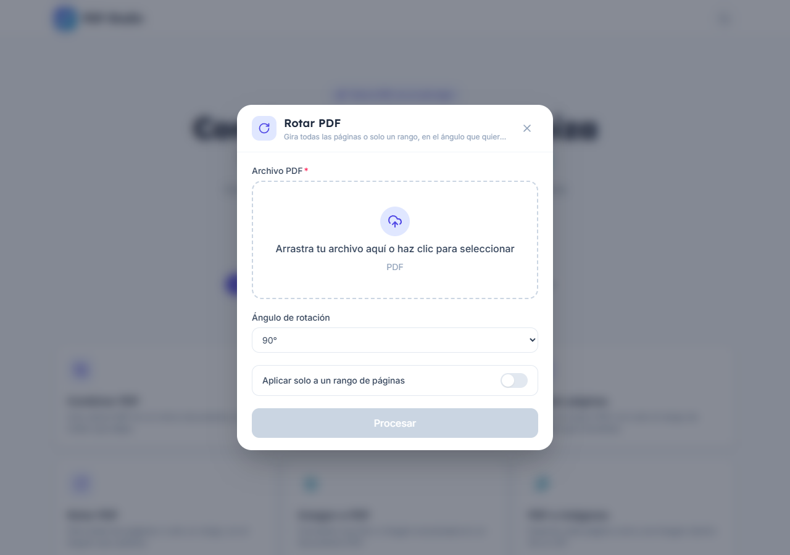
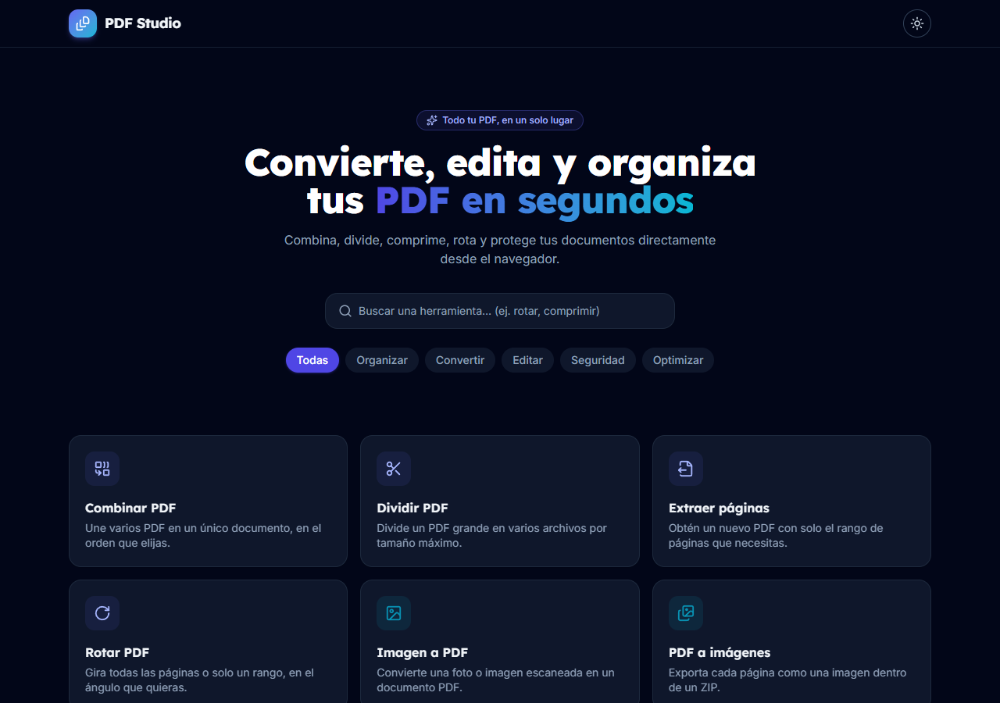
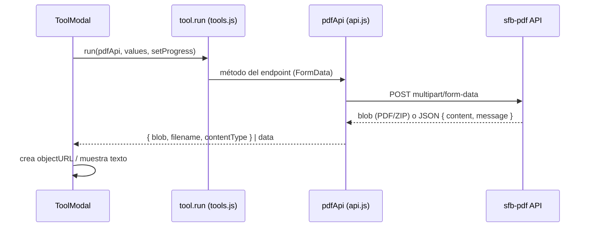

# react-pdf · Frontend de PDF Studio

Interfaz web de [PDF Studio](../README.md). Muestra un catálogo de herramientas PDF (combinar, dividir, rotar, comprimir…); cada una abre un modal con su formulario, sube los archivos a la API [`sfb-pdf`](../sfb-pdf/README.md) y permite descargar el resultado.



## Stack

- [React 19](https://react.dev) + [Vite](https://vite.dev)
- [Tailwind CSS 4](https://tailwindcss.com) (`@tailwindcss/vite`)
- [axios](https://axios-http.com) para las peticiones multipart
- [lucide-react](https://lucide.dev) (iconos) y [react-hot-toast](https://react-hot-toast.com) (notificaciones)
- [Oxlint](https://oxc.rs) para lint

## Funcionalidades

- Catálogo de 10 herramientas con **búsqueda** y **filtro por categoría** (Organizar, Convertir, Editar, Seguridad, Optimizar).
- Modal dinámico generado a partir de la definición de cada herramienta (campos `file`, `files`, `number`, `select`, `toggle`, `password`, `text`).
- Validación de campos, barra de progreso de subida y manejo de errores del backend.
- Vista de resultado con descarga (PDF, ZIP) o texto extraído.
- **Tema claro/oscuro** persistido en `localStorage` (respeta `prefers-color-scheme`).
- Diseño responsive.

| Filtro por categoría | Modal de herramienta | Tema oscuro |
|---|---|---|
|  |  |  |

## Requisitos

- Node.js 20 o superior
- API `sfb-pdf` en ejecución (por defecto `http://localhost:9097`)

## Configuración

Variable de entorno (archivo `.env`):

| Variable | Valor por defecto | Descripción |
|---|---|---|
| `VITE_API_BASE_URL` | `http://localhost:9097/api/pdf` | URL base de la API |

> Vite incrusta esta variable **en tiempo de build**; si la cambias hay que volver a construir.

## Scripts

```bash
npm install        # instala dependencias
npm run dev        # servidor de desarrollo (http://localhost:5173)
npm run build      # build de producción en dist/
npm run preview    # sirve el build localmente
npm run lint       # oxlint
```

## Docker

```bash
docker build -t pdf-studio-frontend .
docker run -p 3003:3000 pdf-studio-frontend
```

El `Dockerfile` es multi-stage: compila con `node:26-alpine` y sirve `dist/` con [`serve`](https://github.com/vercel/serve) en el puerto `3000`. Normalmente se levanta con `docker compose up -d --build` desde la raíz (queda en http://localhost:3003).

## Estructura

```
src/
├── App.jsx                 # layout, búsqueda, filtros, tema
├── main.jsx
├── index.css               # Tailwind + tokens de tema
├── components/
│   ├── Header.jsx          # barra superior y toggle de tema
│   ├── ToolCard.jsx        # tarjeta de herramienta
│   ├── ToolModal.jsx       # formulario, progreso y resultado
│   ├── FileDrop.jsx        # zona de arrastrar y soltar archivos
│   └── Icon.jsx            # mapa nombre → icono lucide
└── lib/
    ├── tools.js            # definición declarativa de categorías y herramientas
    ├── api.js              # cliente axios (pdfApi, downloadBlob, errores)
    └── format.js           # utilidades (formatBytes)
```

## Cómo añadir una herramienta

1. Si el backend expone un endpoint nuevo, agrega su método en `pdfApi` (`src/lib/api.js`).
2. Declara la herramienta en `TOOLS` (`src/lib/tools.js`) con `id`, `title`, `description`, `category`, `icon`, `fields`, `responseType` (`"blob"` o `"json"`) y `run`.
3. Si usa un icono nuevo, regístralo en `Icon.jsx`.

`ToolModal` renderiza el formulario automáticamente a partir de `fields`.

## Flujo de una petición


