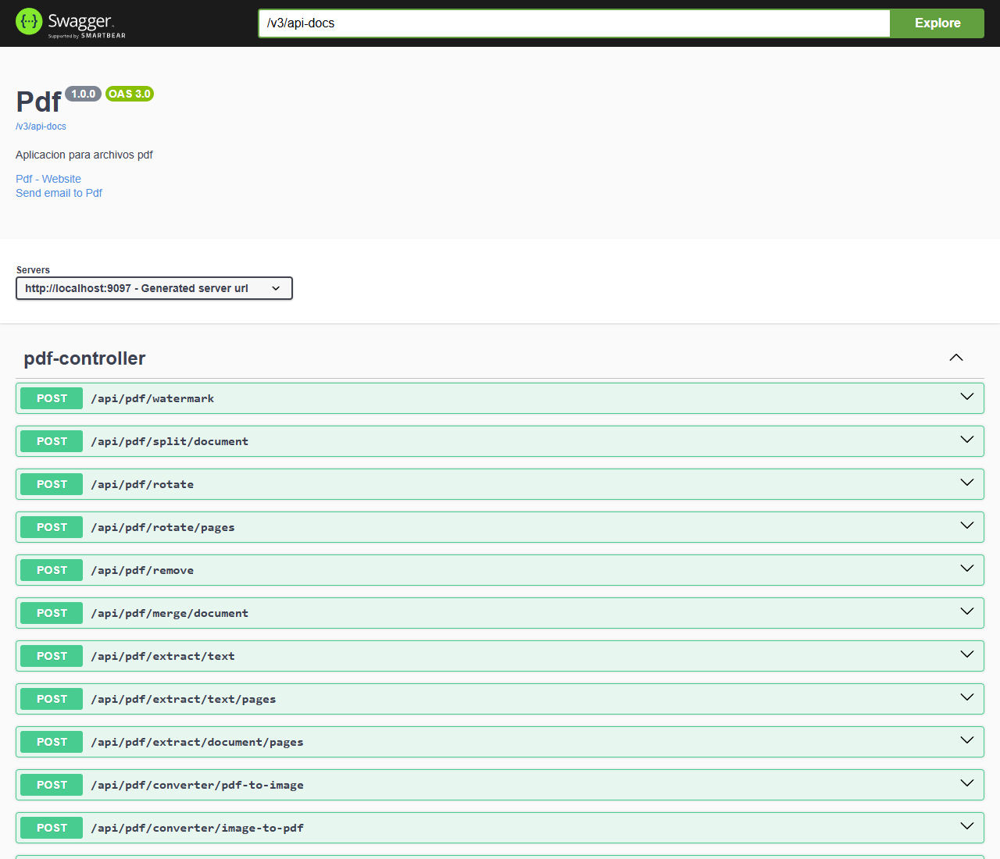
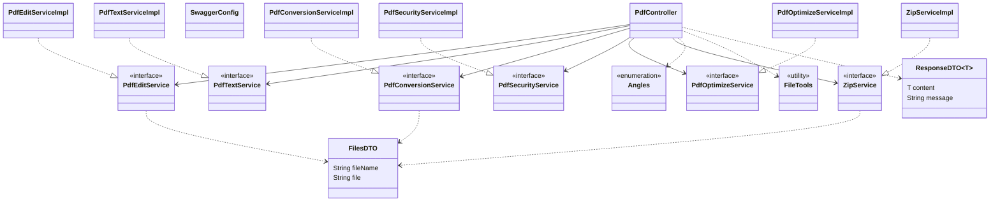
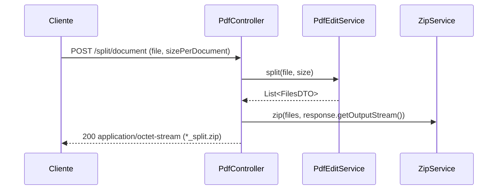

# sbj-pdf · API de PDF Studio

API REST en **Spring Boot 4 / Java 21** que procesa archivos PDF con [Apache PDFBox](https://pdfbox.apache.org). Es el backend de [PDF Studio](../README.md) y lo consume el frontend [`react-pdf`](../react-pdf/README.md).



## Stack

- Java 21, Spring Boot 4.0.1 (`spring-boot-starter-webmvc`)
- Apache PDFBox 2.0.32 (+ `pdfbox-tools` 3.0.3)
- springdoc-openapi 2.5.0 (Swagger UI)
- Lombok
- Maven

## Requisitos

- JDK 21 y Maven 3.9+ (o solo Docker)

## Ejecución

### Maven

```bash
mvn spring-boot:run
# o
mvn clean package && java -jar target/sbj-pdf-1.0.1.jar
```

### Docker

```bash
docker build -t pdf-studio-backend .
docker run -p 9097:9097 pdf-studio-backend
```

O con todo el proyecto desde la raíz: `docker compose up -d --build`.

El `Dockerfile` compila con `maven:3.9.7-amazoncorretto-21` y ejecuta el JAR sobre `amazoncorretto:21-al2023` mediante `run.sh` (zona horaria `America/Mexico_City`; se pueden pasar opciones JVM con `JAVA_OPTS`).

| Recurso | URL |
|---|---|
| API | http://localhost:9097/api/pdf |
| Swagger UI | http://localhost:9097/api/swagger-ui/index.html |
| OpenAPI JSON | http://localhost:9097/api/v3/api-docs |

## Configuración (`application.properties`)

| Propiedad | Valor |
|---|---|
| `server.port` | `9097` |
| `spring.application.name` | `sbj-pdf` |
| `spring.servlet.multipart.max-file-size` | `100MB` |
| `spring.servlet.multipart.max-request-size` | `100MB` |

CORS está abierto (`@CrossOrigin`) y se expone el header `Content-Disposition` para que el navegador lea el nombre del archivo.

## Endpoints

Base: `/api/pdf` · Todos son `POST` con `multipart/form-data`.

| Endpoint | Parámetros | Respuesta |
|---|---|---|
| `/extract/text` | `file` | JSON `ResponseDTO<String>` |
| `/extract/text/pages` | `file`, `start`, `end` | JSON `ResponseDTO<String>` |
| `/rotate` | `file`, `angle` | PDF `*_rotate.pdf` |
| `/rotate/pages` | `file`, `angle`, `start`, `end` | PDF `*_rotate.pdf` |
| `/extract/document/pages` | `file`, `start`, `end` | PDF `*_extract.pdf` |
| `/converter/image-to-pdf` | `file` (imagen) | PDF `*_converter.pdf` |
| `/converter/pdf-to-image` | `file`, `dpi` (def. `300`) | ZIP `*_images.zip` |
| `/merge/document` | `files` (varios PDF) | PDF `files_merge.pdf` |
| `/split/document` | `file`, `sizePerDocument` en bytes (def. `1048576`) | ZIP `*_split.zip` |
| `/compress/document` | `file` | PDF `*_compress.pdf` |
| `/remove` | `file`, `password` (**Base64**) | PDF `*_rm_pwd.pdf` |
| `/watermark` | `file`, `angle`, `watermark` (texto) | PDF `*_watermark.pdf` |

`angle` es el enum `Angles`: `DEGREE_45`, `DEGREE_90`, `DEGREE_180`, `DEGREE_270`, `DEGREE_360`.

### Ejemplos

```bash
# Rotar 90°
curl -X POST http://localhost:9097/api/pdf/rotate \
  -F "file=@documento.pdf" -F "angle=DEGREE_90" -OJ

# Extraer texto de las páginas 1 a 3
curl -X POST http://localhost:9097/api/pdf/extract/text/pages \
  -F "file=@documento.pdf" -F "start=1" -F "end=3"

# Quitar contraseña (la contraseña se envía en Base64)
curl -X POST http://localhost:9097/api/pdf/remove \
  -F "file=@protegido.pdf" -F "password=$(printf 'miClave' | base64)" -OJ

# Combinar varios PDF
curl -X POST http://localhost:9097/api/pdf/merge/document \
  -F "files=@a.pdf" -F "files=@b.pdf" -OJ
```

Formato de respuesta JSON:

```json
{ "content": "texto extraído…", "message": "OK" }
```

## Arquitectura

Capas: **controller → service → PDFBox**. Los endpoints que devuelven archivos escriben directamente en el `OutputStream` de la respuesta; los que generan varios archivos (`split`, `pdf-to-image`) devuelven una lista de `FilesDTO` que `ZipService` empaqueta.





## Estructura

```
src/main/java/com/juniverse/pdf/
├── SbjPdfApplication.java
├── config/SwaggerConfig.java       # metadatos OpenAPI
├── controller/PdfController.java   # endpoints REST
├── dto/                            # FilesDTO, ResponseDTO<T>
├── service/                        # un servicio por capacidad (interfaz + implementación con PDFBox):
│   ├── PdfEditService              #   rotar, extraer páginas, unir, dividir, marca de agua
│   ├── PdfTextService              #   extraer texto
│   ├── PdfConversionService        #   PDF ↔ imágenes
│   ├── PdfSecurityService          #   quitar contraseña
│   ├── PdfOptimizeService          #   comprimir
│   └── ZipService(+Impl)           #   empaquetar varios archivos
└── tools/                          # Angles (enum), FileTools
```

## Pruebas

```bash
mvn test
```

`SbjPdfApplicationTests` comprueba que el contexto de Spring arranca y `PdfServicesTest` prueba cada servicio con PDF generados en memoria (texto, rotación, extracción, unión, división, conversión a imagen, compresión, contraseña y marca de agua).

## Notas

- Las páginas `start`/`end` se pasan tal cual al servicio; consulta `PdfEditServiceImpl` y `PdfTextServiceImpl` para el manejo de rangos fuera de límite.
- La compresión recomprime las imágenes embebidas como JPEG de menor calidad, por lo que es con pérdida.
- La conversión PDF → Word (`/converter/word`) está comentada y no se expone.
- La contraseña de `/remove` va en Base64 (solo codificación); usa HTTPS fuera de entornos locales.
- El límite de subida es de 100 MB por petición.
